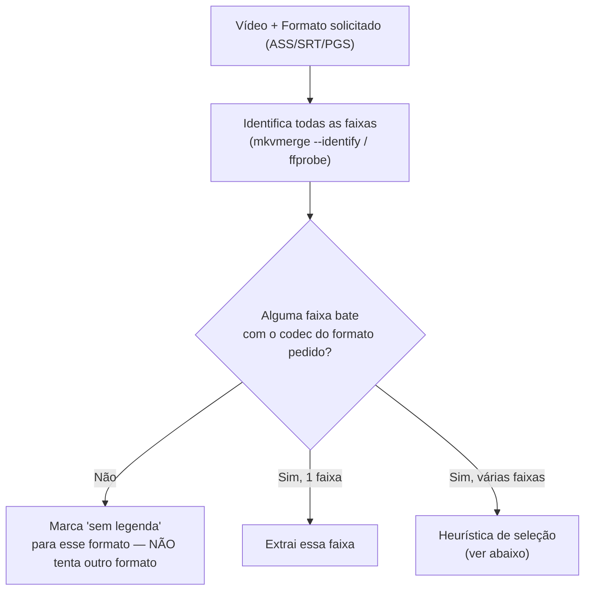
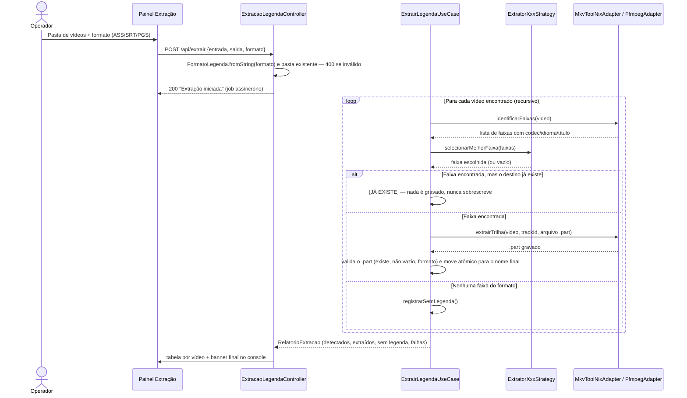

# ✂️ Módulo: Extração de Legendas

[← Análise de Mídia](etapa-1.1-analise-midia.md) | [Troca de Tipo de Legenda →](etapa-1.3-troca-tipo-legenda.md)

---

## Para que serve

Extrai a faixa de legenda embutida de um vídeo para um arquivo independente (`.ass`, `.srt` ou `.sup`), no formato solicitado pelo operador, para que ela possa ser traduzida e depois remuxada de volta. Suporta lote (varredura recursiva de pasta) e dois motores conforme o contêiner do vídeo.


---

## Pacote e classes principais

| Classe | Papel |
|--------|-------|
| `ExtrairLegendaUseCase` (`application`) | Orquestra: varre vídeos, identifica faixas, seleciona a estratégia certa por formato, chama o adapter de extração |
| `FormatoLegenda` (`domain`) — enum `ASS` / `PGS` / `SRT` | Formato solicitado; cada um mapeia para uma extensão de saída (`.ass`, `.sup`, `.srt`) |
| `ExtratorAssStrategy`, `ExtratorPgsStrategy`, `ExtratorSrtStrategy` (`application/strategy`) | Uma estratégia por formato — cada uma filtra as faixas candidatas **estritamente pelo próprio codec**, sem fallback cruzado entre formatos |
| `MkvToolNixAdapter` (`infrastructure/adapters`) | Para contêineres `.mkv`/`.webm` — usa `mkvmerge --identify` + `mkvextract` |
| `FfmpegAdapter` (`infrastructure/adapters`) | Para os demais contêineres (`.mp4`, `.m4v`, `.mov`, `.avi`, `.ts`, `.m2ts`, `.flv`, `.wmv`) — usa `ffprobe` + `ffmpeg -map` |
| `FaixaDeLetreiro` (`application/strategy`) | Regra única, usada pelas três estratégias, que reconhece a faixa reduzida de letreiros/músicas |
| `FormatoLegendaInvalidoException` (`domain/exceptions`) | Lançada quando o formato solicitado é vazio/inválido — o endpoint responde `400` em vez de silenciosamente assumir ASS |

---

## Como o motor escolhe a faixa certa

Cada estratégia filtra as faixas do vídeo **apenas pelo codec compatível com o formato pedido** — não existe fallback que troque de formato silenciosamente (ex.: pedir ASS e receber PGS). Se nenhuma faixa do formato pedido existir no vídeo, ele é contabilizado como **"sem legenda"** no relatório final, e o operador é avisado para tentar outro formato ou verificar hardsub. Se o vídeo tem legenda de **texto** num formato que a extração ainda não converte (`mov_text` do MP4, WebVTT), a mensagem diz isso e avisa que **não é hardsub**.



### Heurística quando há múltiplas faixas do mesmo formato

Antes de tudo, nos três formatos, a faixa que se declara **reduzida** — flag `forced` ou nome com `sign`, `song`, `forced`, `letreiro` ou `s&s` — sai da disputa e só é escolhida se não houver outra candidata (`FaixaDeLetreiro`). A decisão é pelo que a faixa declara, nunca pelo tamanho ou pela posição. Entre as que sobram:

| Formato | Critério de seleção |
|---------|----------------------|
| **ASS** | 1) Palavras-chave no nome da faixa (`dialogue`, `full`, `complete`, `legendado`, `gcs8`, `english`); 2) senão, a **última** candidata da lista |
| **PGS / SRT** | Faixa marcada `default` ou idioma `por`/`eng`; senão, a **primeira** candidata |

> Essa heurística escolhe a faixa certa *dentro do formato correto* — mas não é uma verificação de conteúdo real. Se o relatório de [Análise de Mídia](etapa-1.1-analise-midia.md) mostrar múltiplas faixas ASS com títulos ambíguos, vale conferir manualmente qual foi extraída.

---

## O que a varredura pula

- **Pastas de trabalho `_kronos_*`** abaixo da entrada (cópias e backups gerados pelo próprio sistema). A própria pasta de entrada pode se chamar `_kronos_*` e é percorrida.
- **MKVs publicados pelo remux (`*_PTBR.mkv`)** quando a mesma pasta também tem os originais: a saída do remux não é legenda de origem. O console mostra `[IGNORADOS]` com a contagem, e o banner final traz a linha "MKVs publicados ignorados".
- Pasta que **só** tem MKVs publicados continua extraindo deles.
- O caso de uso processaria sempre um arquivo escolhido diretamente, mas a rota web (e a CLI) só aceitam **pasta** — para extrair de um `_PTBR.mkv` específico, ele precisa estar numa pasta sem os originais.

---

## Fluxo de execução



O banner final diz o desfecho real:

| Banner | Quando |
|--------|--------|
| `[SUCESSO]` | Houve extração, sem falha nem timeout |
| `[ATENÇÃO] ... COM FALHA` | Houve extração, mas algum vídeo falhou ou estourou o tempo |
| `[PARADO]` | O operador interrompeu; o que já foi extraído fica e aparece como `[JÁ EXISTE]` na próxima execução |
| `[AVISO]` | Nenhum arquivo de vídeo suportado foi encontrado |
| `[ALERTA]` | Havia vídeos, mas nenhuma legenda do formato pedido foi extraída |

---

## Nomenclatura do arquivo de saída

```
<nomeOriginalDoVideoSemExtensao>_Track<idDaFaixa>.<extensão>
```

Exemplo: `Episodio01_Track3.ass`. A pasta de saída padrão é `<pastaVideos>/legendas_extraidas_<formato>/` — uma pasta **plana** (não replica subpastas), criada **só quando há legenda para gravar**. Arquivo que já existe nunca é sobrescrito (`[JÁ EXISTE]`); a extração grava primeiro um `.part`, valida (existe, não vazio, formato certo) e só então o move, de forma atômica, para o nome final. Se a varredura recursiva encontrar dois vídeos com o **mesmo nome** em subpastas diferentes (ex.: `Season01/Episodio01.mkv` e `Season02/Episodio01.mkv`), o segundo **não é extraído**: o console marca `[COLISÃO]` e conta como falha (antes de 08/10/2026 ele aparecia como "Já existe (preservado)", que soava como reexecução inofensiva). Nomeie os episódios de forma única entre temporadas, ou extraia temporada por temporada em pastas de saída separadas.

---

## Endpoint REST

### `POST /api/extrair`

```json
{
  "entrada": "C:/animes/[Sokudo] DanMachi/Season 04",
  "saida": "C:/animes/[Sokudo] DanMachi/legendas_extraidas",
  "formato": "ASS"
}
```

| Campo | Obrigatório | Valores aceitos |
|-------|:-----------:|-------------------|
| `entrada` | ✅ | Caminho de **pasta** existente (varrida recursivamente). Arquivo avulso ou pasta inexistente retorna `400` |
| `saida` | ⚪ | Se omitido, usa `<entrada>/legendas_extraidas_<formato>/` |
| `formato` | ✅ | `ASS`, `SRT` ou `PGS` (case-insensitive) — vazio/inválido retorna `400` |

**Formatos de vídeo suportados:** `.mkv`/`.webm` (via MKVToolNix) e `.mp4`/`.m4v`/`.mov`/`.avi`/`.ts`/`.m2ts`/`.flv`/`.wmv` (via ffmpeg).

---

## Navegação

| Anterior | Próximo |
|----------|---------|
| [← Análise de Mídia](etapa-1.1-analise-midia.md) | [Troca de Tipo de Legenda →](etapa-1.3-troca-tipo-legenda.md) |
