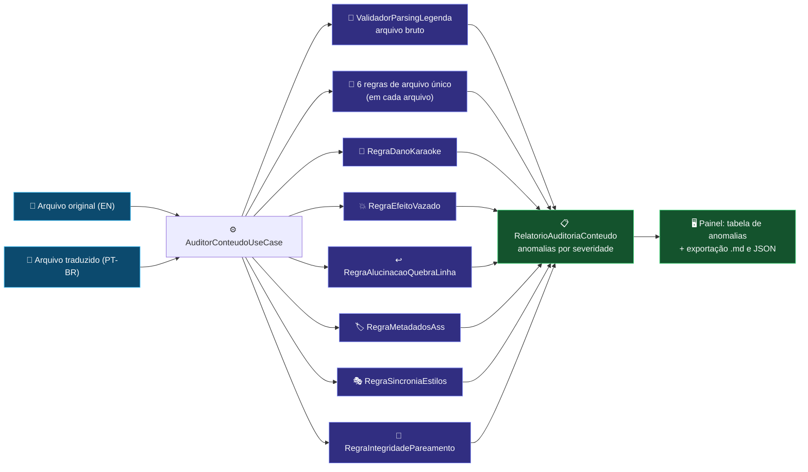

# 🔎 Módulo: Análise de Conteúdo de Legendas

[← Troca de Tipo de Legenda](etapa-1.3-troca-tipo-legenda.md) | [Tradução Local (LLM) →](etapa-2.1-traducao-llm.md)

---

## Para que serve

Painel **"1.4 Análise de Legenda"** da SPA (grupo **Preparação**) — também chamado de **Análise de Conteúdo**. Audita legendas `.ass`/`.ssa`/`.srt` — **um arquivo** de cada lado, não uma pasta — **antes e depois da tradução**, procurando anomalias que nenhuma etapa individual enxerga sozinha: efeitos de karaokê destruídos por LLM, tags vazadas para o texto visível, quebras de linha alucinadas e metadados inconsistentes. Existe porque **blindagem por nome de estilo não é confiável entre releases** — cada fansub estrutura legendas de um jeito, então o fluxo seguro é extrair → **auditar o que veio** → traduzir.

### Três modos (abas internas)

O card de entrada tem uma barra de abas que escolhe o **escopo** da análise:

| Aba | Modo | Arquivos | Regras aplicadas |
|-----|------|----------|------------------|
| **Ambas (comparar)** | `AMBAS` | original + traduzido | 6 regras **comparativas** (par original ↔ traduzido) + as de arquivo único nos dois lados |
| **Só Original (EN)** | `ORIGINAL` | só o original | 6 regras de **arquivo único** (estruturais + tempo) |
| **Só Traduzida (PT-BR)** | `TRADUZIDO` | só o traduzido | 6 regras de **arquivo único** (estruturais + tempo) |

As regras de arquivo único não dependem de referência: tags `{}` não fechadas, timestamp inválido (fim ≤ início), evento de diálogo vazio, quebras `\N` excessivas, sobreposição de tempo entre diálogos e efeito visual com texto longo (possível vazamento). No modo `TRADUZIDO` a anomalia é rotulada no lado traduzido; no `ORIGINAL`, no lado original.

Em todos os modos roda também a **validação de parsing** do arquivo bruto (`ValidadorParsingLegenda`): bloco SRT truncado, índice SRT não numérico e linha `Dialogue`/`Comment` ASS malformada — corrupções que os leitores tolerantes esconderiam.

---

## Pacote e classes principais

| Classe | Papel |
|--------|-------|
| `AuditorConteudoUseCase` (`application`) | Orquestra as regras sobre cada par original ↔ traduzido e monta o relatório |
| `RegraIntegridadePareamento` (`application/regras`) | Confere se o par descreve as mesmas falas; com fala a mais/a menos, aponta **onde o par se desfaz** (alinhando pelo tempo) com as duas falas daquele ponto |
| `RegraDanoKaraoke` (`application/regras`) | Detecta letra de música original (romaji/JP) destruída ou traduzida indevidamente |
| `RegraEfeitoVazado` (`application/regras`) | Tags de efeito ASS vazando como texto visível na tela |
| `RegraAlucinacaoQuebraLinha` (`application/regras`) | Quebras `\N` inventadas ou removidas pelo LLM |
| `RegraMetadadosAss` (`application/regras`) | Cabeçalho/metadados `.ass` alterados indevidamente |
| `RegraSincroniaEstilos` (`application/regras`) | Estilos divergentes entre original e traduzido (evento a evento) |
| 6 regras de arquivo único (`application/regras/arquivounico`) | `RegraTagOverrideNaoFechada`, `RegraTimestampInvalido`, `RegraEventoDialogoVazio`, `RegraQuebrasLinhaExcessivas`, `RegraSobreposicaoTempo`, `RegraEfeitoComTextoLongo` |
| `ValidadorParsingLegenda` (`application`) | Validação de parsing do arquivo bruto (somente leitura) |
| `TelemetriaAuditoriaService` (`application`) | Registra cada análise na telemetria e manda gravar o relatório JSON |
| `AuditoriaConteudoPersistencia` (`infrastructure`) | Grava o relatório JSON da auditoria com nome único (`auditoria_conteudo_<timestamp>_<seq>.json`) |
| `ModoAuditoria` (`domain`) | Enum `AMBAS` / `ORIGINAL` / `TRADUZIDO` |
| `AnomaliaConteudo` / `RelatorioAuditoriaConteudo` (`domain`) | Modelo das anomalias com severidade + relatório agregado |
| `AuditorConteudoController` (`presentation`) | Endpoint REST síncrono — devolve o relatório na própria resposta |

---

## Fluxo de auditoria

---

## Endpoints REST

| Endpoint | Payload | Retorno |
|----------|---------|---------|
| `POST /api/auditoria-conteudo` | `{modo?, caminhoOriginal?, caminhoTraduzido?}` | `RelatorioAuditoriaConteudo` (JSON, síncrono) |

`modo` aceita `AMBAS` (default se ausente — retrocompatível), `ORIGINAL` ou `TRADUZIDO`. O modo determina quais caminhos são obrigatórios: `AMBAS` exige os dois; `ORIGINAL` exige `caminhoOriginal`; `TRADUZIDO` exige `caminhoTraduzido`. Modo preenchido mas desconhecido responde `400` (não vira `AMBAS`); arquivo ausente ou fora de `.ass`/`.ssa`/`.srt` também responde `400`. O relatório retornado inclui o campo `modo` para a tela e a exportação (`.md` ou JSON) se adaptarem.

Diferente dos jobs longos, a auditoria responde o relatório **na própria requisição** (leitura pura, sem LLM). O log detalhado sai no canal SSE `auditor-conteudo`, encerrando com a linha `[RELATÓRIO FINAL]` padrão (operação + tempo total + hora local).

---

## Pontos de atenção

- A auditoria **nunca altera as legendas**; o que ela grava é só o relatório JSON da auditoria, em `relatorios/`, e a telemetria. A correção é feita pelos módulos de [Correção](etapa-2.3-correcao-revisao.md), [Correção de Karaoke](etapa-4.2-cura-tags.md) e [Karaokê](etapa-4.1-traducao-karaoke.md).
- A `RegraDanoKaraoke` nasceu do caso real do 86 (Eighty-Six): a faixa original havia sido destruída pela tradução automática de romaji — ver [Memória de Decisões da IA](ref-memoria-decisoes-ia.md).
- **Pareamento deslocado.** As regras comparativas pareiam evento a evento **pela posição**. Quando original e traduzido não têm o mesmo número de eventos (fala apagada, inventada, ou Comentário só de um lado), a posição k de um lado deixa de ser a fala k do outro: só a integridade do pareamento roda, ela aponta o ponto em que o par se desfaz, e as demais saem **nomeadas** na anomalia *Regras Comparativas Puladas* — antes elas rodavam e acusavam centenas de falas trocadas que não existiam (auditoria de 08/10/2026).
- **Nenhuma Fala Auditada** (`ERROR`): o arquivo não tem nenhuma fala `Dialogue` legível. Nada foi auditado, e a falta de outras anomalias **não** quer dizer arquivo limpo.
- **Formatos Incompatíveis para Comparação** (`CRITICAL`): no modo `AMBAS`, ASS/SSA de um lado e SRT do outro — o índice ASS é posicional e o SRT é o número do bloco, então as regras comparativas são puladas. Use o mesmo formato nos dois lados ou audite cada arquivo no modo de arquivo único.
- Rode a auditoria **duas vezes** no ciclo: após a extração (linha de base do release) e após a tradução (diff de anomalias introduzidas).

---

## Navegação

| Anterior | Próximo |
|----------|---------|
| [← Troca de Tipo de Legenda](etapa-1.3-troca-tipo-legenda.md) | [Tradução Local (LLM) →](etapa-2.1-traducao-llm.md) |
