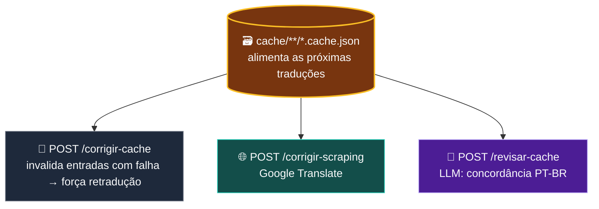
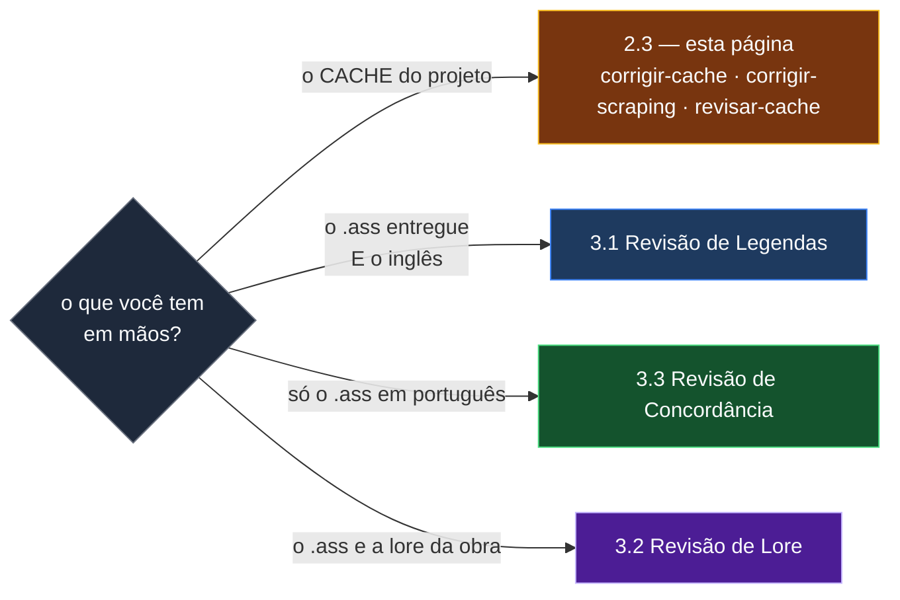

# 🗃️ Etapa 2.3 — Correção de Cache

[← 2.2 Tradução sem Lore](etapa-2.2-traducao-sem-lore.md) | [3.1 Revisão de Legendas →](etapa-3.1-revisao-legendas.md)

---

## Para que serve

Depois da tradução inicial sobram, tipicamente, dois problemas: **falas que o LLM não traduziu**
(resíduo em inglês, fallback silencioso) e **erros de concordância de gênero em PT-BR** — o inglês
não marca gênero em pronomes e adjetivos como o português, e `"her sword"` vira `"sua espada dele"`
por calque.

Esta tela ataca os dois **no banco de cache**, que é o que alimenta as próximas traduções. Para
consertar a legenda **já entregue**, as telas são a [3.1](etapa-3.1-revisao-legendas.md), a
[3.2](etapa-3.2-revisao-lore.md) e a [3.3](etapa-3.3-revisao-concordancia.md).

---

## Os três fluxos sobre o cache

| Endpoint | Use case | Atua sobre | Método |
|----------|----------|-------------|--------|
| `POST /api/corrigir-cache` | `LimparCacheUseCase` | `cache/**/*.cache.json` | **Nenhum corretor** — invalida (`traduzido = ""`) as entradas que o `ClassificadorEntradaCacheService` marca como falha, forçando retradução na próxima passada de `/api/traduzir` |
| `POST /api/corrigir-scraping` | `CorrigirComGoogleUseCase` | `cache/**/*.cache.json` | **Google Translate** (scraping da API pública `translate.googleapis.com`) |
| `POST /api/revisar-cache` | `RevisarCacheUseCase` | `cache/**/*.cache.json` | **LLM local** — foco em concordância PT-BR |

> **Quando usar qual:** se a legenda final ainda tem falas 100% em inglês, comece por
> `/corrigir-cache` e rode `/traduzir` de novo — é o mais barato e reaproveita o LLM já
> configurado. Se restarem resíduos, `/corrigir-scraping` entrega algo melhor que "sem tradução
> nenhuma", sem custo. Para erro sutil de gênero, `/revisar-cache` é mais lento, mas entende a lore
> do contexto.
>
> **Escopo:** sem `contextoId`, a varredura pega todos os caches da pasta; com `contextoId`, só os
> caches daquela obra, pela **proveniência** gravada em cada arquivo (cache antigo sem proveniência
> entra). As subpastas `karaoke/`, `auditoria/` e `sem_lore/` nunca são tocadas.
>
> **O cache é propriedade de um dono único** (o peer `cachetraducao`). Nenhuma outra fatia escreve
> nele — ver [Arquitetura](arquitetura.md).

---

## Fluxo 1 — Limpeza de cache (`traducaoCorrige`)

`LimparCacheUseCase` varre os `*.cache.json` e **invalida** (`traduzido = ""`) as entradas que o `ClassificadorEntradaCacheService` marca como `NAO_TRADUZIDA` (idêntica ao original sem que a lore autorize), `INVALIDA` (reprovada pela validação da tradução) ou `ROMAJI_TRADUZIDO` (camada de romaji com tradução gravada). Tradução idêntica que a lore autoriza (nome, sigla, termo protegido) e linhas protegidas (karaokê, estilos musicais, linhas gráficas) ficam como estão. Cada arquivo alterado ganha backup e escrita atômica. Não chama nenhum serviço externo; o objetivo é só preparar o terreno para que a próxima execução de [`/api/traduzir`](etapa-2.1-traducao-llm.md) trate essas falas como pendentes de novo.

---

## Fluxo 2 — Correção/Revisão via Google Translate (`raspagemCorrecao`)

- **`GoogleTranslateScraper`** (`infrastructure`, reutilizado por `raspagemRevisao`) chama `https://translate.googleapis.com/translate_a/single?client=gtx&sl=en&tl=pt&dt=t&q=...` via `java.net.http.HttpClient` — a API pública não-oficial do Google Translate, não a API paga do Google Cloud.
- Mascara tags ASS (`{...}` → `[T0]`) e quebras de linha (`\N` → `[B]`) antes de enviar, restaura na resposta — mesmo princípio do `MascaradorTags` da tradução principal.
- Só vão ao Google as entradas que o mesmo `ClassificadorEntradaCacheService` marca como falha. Os termos protegidos da lore do próprio cache são mascarados antes pelo `ProtetorTermosLoreService` e restaurados na volta; se a restauração não fecha, a entrada continua pendente.
- Pausa de 400ms entre chamadas (rate-limit informal da API pública).
- Para corrigir direto no `.ass` entregue, a tela é a [3.1 Revisão de Legendas](etapa-3.1-revisao-legendas.md).

---

## Fluxo 3 — Revisão do cache via LLM (`raspagemRevisao`)

`POST /api/revisar-cache` → `RevisaoCacheController` → `RevisarCacheUseCase`. Revisa concordância, gênero e resíduos em traduções **válidas** já gravadas no cache, usando a lore da proveniência de cada arquivo; entradas vazias ou inválidas ficam para a tradução ou para o Google. Antes de começar, confere se o LLM local está carregado. Resposta ausente, alucinada ou que não reduz o problema é descartada, e toda alteração tem backup, escrita atômica e auditoria.

---

## Reforço de terminologia (ensaio / aplicar)

`ReforcarTerminologiaCacheUseCase` aplica a terminologia da lore às traduções **já gravadas** no cache, sem retraduzir.

- `POST /api/reforcar-terminologia-ensaio` percorre o cache e conta o que mudaria, por termo, **sem gravar nada**.
- `POST /api/reforcar-terminologia-aplicar` grava, com backup e escrita atômica. Na tela, o botão **Aplicar** só destrava depois de um ensaio no mesmo alvo — trocar a pasta ou a obra trava de novo. No servidor, a rota responde `409` enquanto `correcao-cache.reforco-terminologia-aplicar-habilitado` estiver `false` (o padrão), sem ler nem escrever nada.

---

## Fluxos de arquivo — mudaram de lugar (e por quê)

Esta página já descreveu também dois fluxos que atuam **direto no arquivo `.ass` entregue**. Eles
cresceram, ganharam tela própria numerada no menu e **página própria** — manter a descrição aqui
criaria duas fontes de verdade sobre o mesmo assunto, que é o que a invariante de fonte única
proíbe.

| era aqui | mora agora em | atua sobre |
|---|---|---|
| revisão de concordância PT-BR via LLM, no `.ass` | **[3.1 Revisão de Legendas](etapa-3.1-revisao-legendas.md)** | os `.ass` PT-BR entregues, com o inglês de referência |
| concordância de gênero determinística | **[3.3 Revisão de Concordância](etapa-3.3-revisao-concordancia.md)** | só o `.ass` PT-BR, sem inglês, sem cache e sem LLM |

A diferença que decide qual usar:

> **Regra prática:** o cache alimenta as próximas traduções; o `.ass` é a entrega. Corrigir o cache
> não conserta a legenda que já saiu, e corrigir a legenda não impede o erro de voltar na próxima
> tradução. Por isso os dois lados existem.

---

## Endpoints REST desta tela

| Endpoint | Payload | Canal SSE |
|----------|---------|-----------|
| `POST /api/corrigir-cache` | `{entrada?, contextoId?}` (padrão: pasta `cache`) | `correcao` |
| `POST /api/corrigir-scraping` | `{entrada?, contextoId?}` | `correcao` |
| `POST /api/revisar-cache` | `{entrada?, contextoId?}` | `correcao` |
| `POST /api/reforcar-terminologia-ensaio` | `{entrada?, contextoId?}` | `correcao` |
| `POST /api/reforcar-terminologia-aplicar` | `{entrada?, contextoId?}` — `409` com a escrita desligada | `correcao` |

Em todas, `entrada` vazia usa a pasta `cache`, e `contextoId` desconhecido responde `400`.

Os endpoints que atuam no `.ass` (`/api/revisar-legendas`, `/api/revisar-legendas-concordancia`,
`/api/revisar-concordancia`) estão documentados nas páginas 3.1 e 3.3.

---

## Navegação

| Anterior | Próximo |
|----------|---------|
| [← 2.2 Tradução sem Lore](etapa-2.2-traducao-sem-lore.md) | [3.1 Revisão de Legendas →](etapa-3.1-revisao-legendas.md) |
