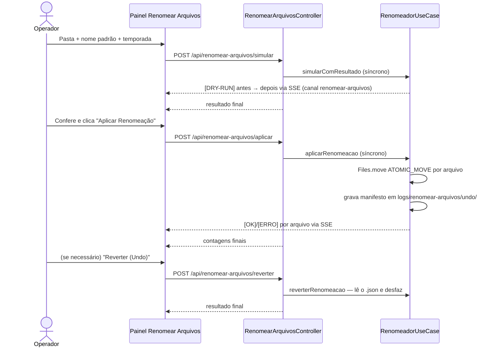

# 🧹 Módulo: Renomear Arquivos

[← 5.1 Remuxer](etapa-5.1-remuxer.md) | [Contextos & Lore →](modulo-contextos-lore.md)

---

## Para que serve

Painel **"5.2 Renomear Arquivos"** da SPA (grupo **Finalização**). Renomeia em lote arquivos de vídeo — e as legendas da mesma pasta (`.ass`, `.ssa`, `.srt`, `.vtt`, `.sub`) — com nomes confusos de release groups de tracker (ex.: `[DB]86_-_01_(Dual Audio_10bit_BD1080p_x265)_PTBR.mkv`) para um padrão limpo `Nome do Anime - S01E01.mkv`, extraindo o número do episódio por **regex** — com simulação prévia (dry-run) e **reversão completa (undo)**.


---

## Pacote e classes principais

| Classe | Papel |
|--------|-------|
| `RenomeadorUseCase` (`application`) | Simula, aplica e reverte a renomeação; extrai o episódio por regex; salva o manifesto de reversão dentro do projeto |
| `OperacaoRenomeacao` (`domain`) | Record da operação (id, data, pasta, lista de `ItemRenomeado` original → novo) |
| `RenomearArquivosController` (`presentation/web`) | Endpoints REST (JAX-RS) — simular, aplicar e reverter **síncronos**: a resposta só sai com o resultado final |
| `RenomearArquivosRequest` (`presentation/web`) | Record do payload `{caminhoOrigem, nomePadrao, temporada}` |

---

## Como o episódio é extraído

1. Tags entre colchetes (`[SubsPlease]`, `[ABCD1234]`) são removidas antes da análise.
2. **`SxxEyy` tem prioridade** sobre tudo. Sub-episódio logo depois dele (`S01E03-5`, `S01E03-E04`) **não** é renomeado — o número do `SxxEyy` não é o episódio inteiro.
3. **Padrão de separador ou rótulo**: `- 01`, `Ep 03`, `Episódio 03`, `E04`, `Episode 12`.
4. **Fallback**: o **último** número isolado de 1 a 4 dígitos, depois de tirar do nome codec, resolução, ano e versão (`v2`).
5. Sem número identificável → o arquivo é **mantido intacto** (nunca renomeia no chute).

**Conteúdo especial é ignorado**: `NCOP`, `NCED`, `OVA`, `OAD`, `SP`, `PV`, `Menu`, `Preview`, `Special` e a temporada `S00Eyy`.

**Filme**: pasta com **um só vídeo sem marcador explícito de episódio** é tratada como filme e vira `<Nome Novo Padrão><extensão>`, sem `SxxEyy` (o ano ou número do título não vira episódio).

Na série, o nome final é `"<Nome Novo Padrão> - S<TT>E<NN><extensão original>"`, com a temporada do pedido ou, sem ela, inferida do nome padrão (`Season 4`, `Temporada 2`, `Temp1`); sem indicação, `S01`.

---

## Fluxo com segurança de reversão



- **Dry-run primeiro, sempre**: a simulação lista cada `antes → depois` sem tocar em nada.
- **Undo garantido sem sujar a mídia**: ao aplicar, um manifesto `kronos_undo_renomeacao_<hash>.json` é salvo em `logs/renomear-arquivos/undo/` dentro do projeto; "Reverter" o lê e desfaz os `move` (o manifesto só é apagado se a reversão terminar sem erros). Aplicar de novo na mesma pasta **não apaga** o desfazer anterior: ele vai para uma pilha (`kronos_undo_renomeacao_<hash>.pilha-NNNN.json`), e cada "Reverter" completo devolve o anterior — reverter duas vezes volta ao nome de antes da primeira aplicação (antes de 08/10/2026 a segunda aplicação sobrescrevia o manifesto e o nome original se perdia).
- Conflitos (destino já existe) são **pulados com erro logado** — nunca sobrescreve.
- Cada arquivo renomeado incrementa a métrica `arquivosSanitizados` na [Telemetria](modulo-telemetria.md).

---

## Endpoints REST

| Endpoint | Payload | Canal SSE |
|----------|---------|-----------|
| `POST /api/renomear-arquivos/simular` | `{caminhoOrigem, nomePadrao, temporada}` | `renomear-arquivos` |
| `POST /api/renomear-arquivos/aplicar` | `{caminhoOrigem, nomePadrao, temporada}` | `renomear-arquivos` |
| `POST /api/renomear-arquivos/reverter` | `{caminhoOrigem}` | `renomear-arquivos` |

```json
{ "caminhoOrigem": "C:/animes/[SubsPlease] Nome Anime", "nomePadrao": "Nome Anime", "temporada": 1 }
```

`caminhoOrigem` é **obrigatório** (`400` se ausente). A tela exige `temporada` entre **1 e 99**; o backend aceita `temporada` ausente (infere do nome padrão) e recusa valor fora da faixa com `400`. Os três endpoints são **síncronos**: a resposta `200` só sai com o resultado final da operação. Pasta já ocupada por outra operação de renomeação responde `409`; erro inesperado, `500`. O console do painel mostra o detalhe por arquivo.

---

## Pontos de atenção

- A temporada vale para a pasta inteira — para várias temporadas, renomeie uma pasta por temporada, informando o número de cada uma.
- Renomear vídeos **depois** de traduzir/remuxar quebra o pareamento vídeo ↔ legenda do [Remuxer](etapa-5.1-remuxer.md) — o lugar natural do Renomear Arquivos é **antes** da Análise de Mídia ou **após o remux final**, na coleção pronta.
- A pasta alvo de mídia não recebe manifesto, backup ou arquivo operacional do KRONOS. O undo fica em `logs/renomear-arquivos/undo/` dentro do projeto.

---

## Navegação

| Anterior | Próximo |
|----------|---------|
| [← 5.1 Remuxer](etapa-5.1-remuxer.md) | [Contextos & Lore →](modulo-contextos-lore.md) |
