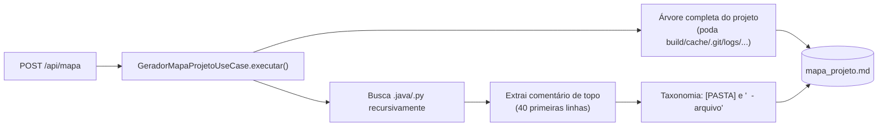

# 🗺️ Módulo: Mapa do Projeto

[← Metadados de Anime](modulo-metadados-anime.md) | [API REST — Referência →](ref-api-endpoints.md)

---

## Para que serve

Gera automaticamente o `mapa_projeto.md` na raiz do repositório — um índice de todos os arquivos `.java`/`.py` do projeto com o comentário/docstring de topo de cada um, servindo como mapa de contexto rápido (para humanos ou para uma LLM) sem precisar abrir cada arquivo.


---

## Como funciona

`GeradorMapaProjetoUseCase` (`mapaProjeto/application/`) é **análise estática simples via regex/parsing de texto — não usa LLM**:

1. Percorre o projeto **inteiro**, podando em qualquer nível: as pastas `.git`, `.venv`, `__pycache__`, `.idea` e as de configuração de editor, `docs`, `multiplexar`, `legendas-traduzidas-ptbr`, `.gradle`, `build`, `bin`, `cache`, `target`, `node_modules`, `relatorios`, `logs` e `backups`; nomes com prefixo `junit-` (resíduo de teste); e arquivos com sufixo `.tmp` ou `.part`.
2. Monta a **árvore de diretórios completa** (seção `1. ARVORE DE DIRETORIOS`).
3. Busca recursivamente arquivos `.java` e `.py` e, para cada um, extrai o **cabeçalho explicativo** — Javadoc/comentário de bloco no topo do `.java`, ou docstring/comentários `#` no topo do `.py` — lendo só as **40 primeiras linhas**.
4. Monta a **taxonomia em texto plano** (seção `2. TAXONOMIA DOS ARQUIVOS-FONTE`): uma linha `[PASTA] <caminho relativo>/` por pasta e, abaixo, `  - <arquivo>` seguido do cabeçalho recuado (ou `(sem cabecalho explicativo)`). Grava por cima de `mapa_projeto.md`.



> ⚠️ **Nota de manutenção:** o cabeçalho gerado sempre traz a linha `Memoria viva do projeto`, que aponta para um arquivo `.md` na raiz do repositório. Esse arquivo **não existe** neste projeto — é texto fixo no gerador. Ignore essa linha ao ler o mapa.

---

## Endpoint REST

### `POST /api/mapa`

Sem payload. Regenera `mapa_projeto.md` na raiz do repositório, de forma **síncrona**, e devolve o
resultado pronto para a tela:

```json
{ "conteudo": "<o texto completo do mapa>", "arvoreGithub": "<a árvore em markdown, em bloco de código>", "nomeProjeto": "<nome da pasta raiz>" }
```

---

## Relação com esta documentação (`docs/`)

O `mapa_projeto.md` é um **índice plano gerado automaticamente**, útil para varredura rápida por uma ferramenta ou para achar em qual arquivo uma função mora. Esta documentação (`docs/`), por outro lado, é **escrita e mantida manualmente**, explicando *como os módulos se relacionam entre si*, decisões de arquitetura e fluxos de negócio — os dois são complementares, não substitutos um do outro.

---

## Navegação

| Anterior | Próximo |
|----------|---------|
| [← Metadados de Anime](modulo-metadados-anime.md) | [API REST — Referência →](ref-api-endpoints.md) |
